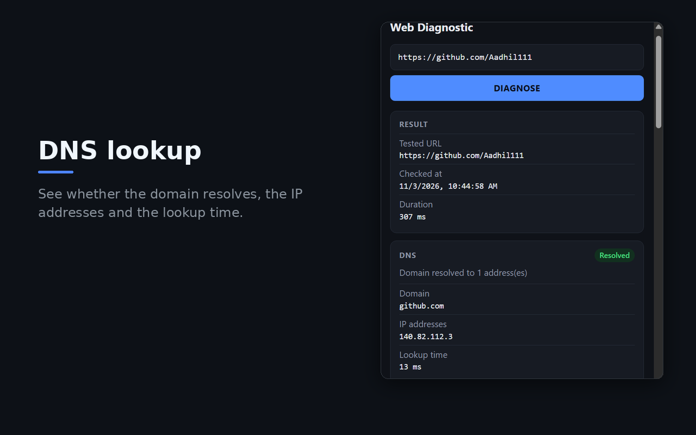
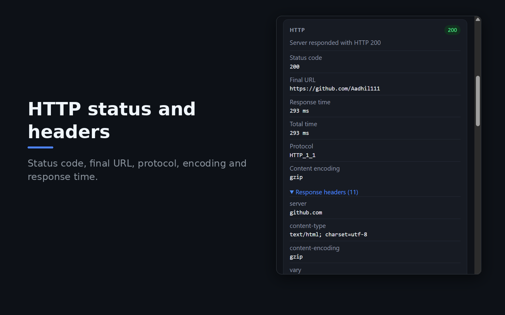
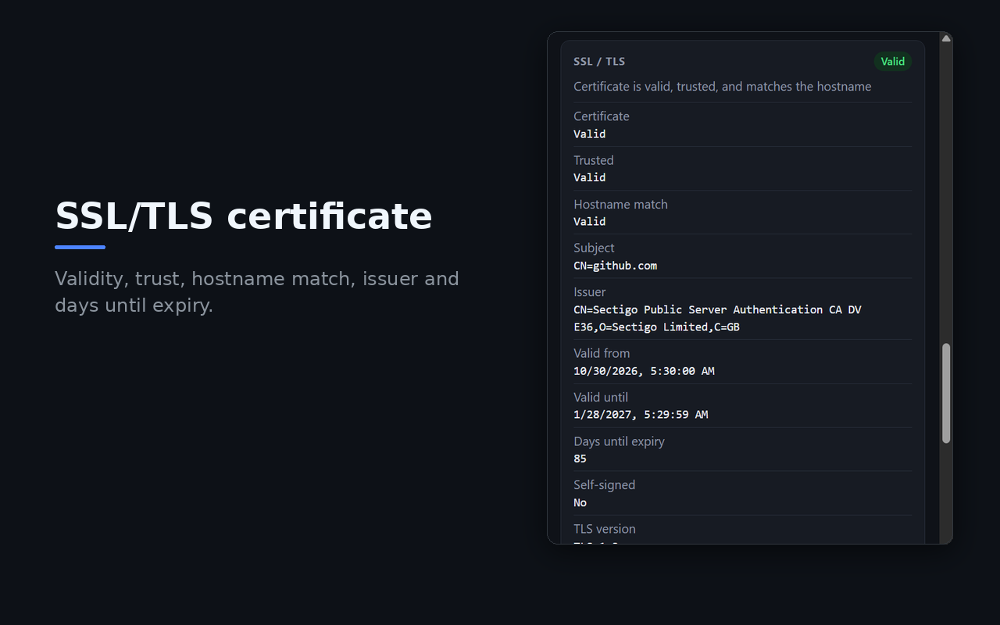
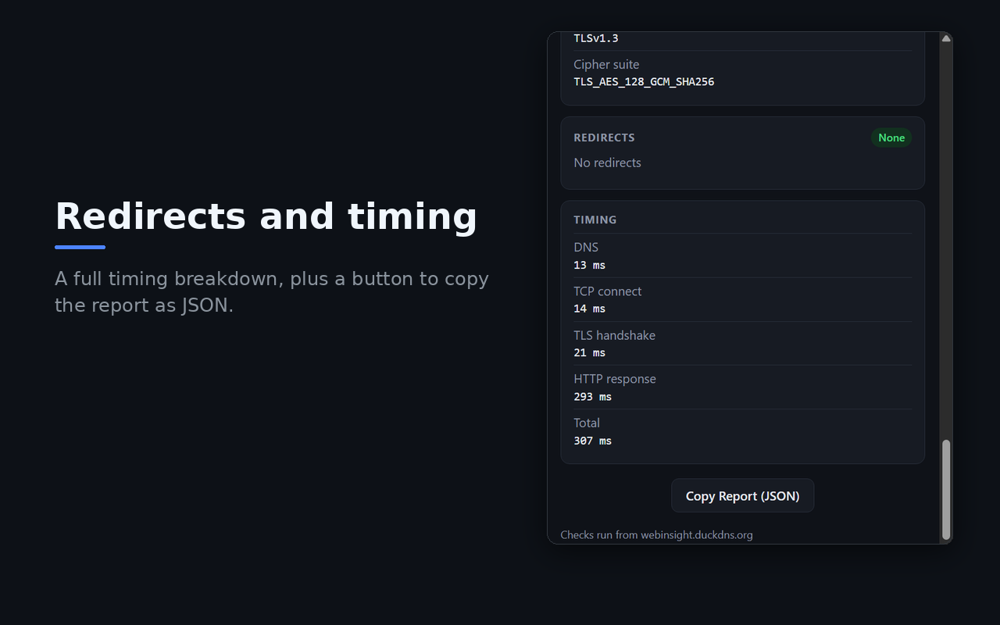

# Web Diagnostic: Chrome extension

Check any website from your browser. One click shows its DNS, HTTP, redirect, SSL/TLS and timing results in a single popup.

[Install from the Chrome Web Store](https://chromewebstore.google.com/detail/web-diagnostic/lfomgibolicppnokhaphgkndjnahhddd) ·
[Live website](https://webinsight.duckdns.org/) ·
[Backend repo](https://github.com/Aadhil111/web-diagnostic-backend) ·
[Website repo](https://github.com/Aadhil111/web-diagnostic-website)

<table>
<tr>
<td align="center"><br><sub>DNS lookup</sub></td>
<td align="center"><br><sub>HTTP status and headers</sub></td>
</tr>
<tr>
<td align="center"><br><sub>SSL/TLS certificate</sub></td>
<td align="center"><br><sub>Redirects and timing</sub></td>
</tr>
</table>

## What it does

Open a website, click the icon and press DIAGNOSE. The popup shows:

- DNS: whether the domain resolves, the IP addresses and the lookup time
- HTTP: final status code, protocol, content encoding and selected response headers
- Redirects: every hop, with loop detection
- SSL/TLS: certificate validity, trust, hostname match, issuer, expiry and TLS version
- Timing: DNS, TCP connect, TLS handshake and HTTP response

The checks run on the Web Diagnostic server, not in the browser, so the result shows how the site looks from the outside instead of from your own network, cache or extensions. The full report can be copied as JSON for bug reports.

## How it fits together

```
Chrome extension ──https──┐
                          ├──> Caddy ──> Spring Boot API (Java 21)
Website ──────────────────┘
```

This is one of three repositories:

- [web-diagnostic-backend](https://github.com/Aadhil111/web-diagnostic-backend): the Spring Boot API and the Docker Compose + Caddy deployment
- [web-diagnostic-website](https://github.com/Aadhil111/web-diagnostic-website): the website, served by the same Caddy as the API
- web-diagnostic-extension (this one): calls the same API at the same address as the website

The extension has no diagnostic logic. It sends `POST {API}/api/v1/diagnostic` with `{"url": "..."}` and draws the JSON the backend returns.

## Tech stack

| | |
|---|---|
| Extension | Chrome Manifest V3, with the `activeTab` permission and the `chrome.tabs` API |
| Frontend | HTML, CSS and plain JavaScript (Fetch API), no framework and no build step |
| Backend | The [Spring Boot API](https://github.com/Aadhil111/web-diagnostic-backend) (Java 21), behind Caddy on AWS EC2 |
| Distribution | Chrome Web Store |

## Design choices

- Manifest V3 with the smallest permission set that works: `activeTab` and one host permission (the API).
- Nothing is sent until you press DIAGNOSE. The address pre-filled from the current tab has its query string and fragment removed first, and the backend drops query strings too.
- All JavaScript is inside the package: no remote code, no `eval`, no inline scripts.
- Anything that comes back from the network is put into the page with `textContent`, never `innerHTML`.
- Plain HTML, CSS and JavaScript, no framework and no runtime dependencies.
- No account, no tracking, no ads. The privacy policy is at [webinsight.duckdns.org/privacy.html](https://webinsight.duckdns.org/privacy.html).

## Project structure

```
manifest.json     Manifest V3: the "activeTab" permission and one host permission (the API)
popup.html        the popup
app.js            the whole app (same file as the website's app.js)
platform.js       what differs from the website: API_BASE_URL and the pre-fill from the current tab
style.css
icons/            16, 32, 48 and 128 px icons
docs/             screenshots used in this README (not part of the extension)
STORE_LISTING.md  text and answers for the Chrome Web Store dashboard
```

## Set your domain

If you run your own copy, put the address your backend is served from (same as the website) in two places before loading or publishing the extension:

- `platform.js`: `const API_BASE_URL = 'https://<your-domain>';`
- `manifest.json`: `"host_permissions": ["https://<your-domain>/*"]`

Use `https://`, no trailing slash, no path. If `API_BASE_URL` still contains the `your-domain` placeholder, the popup says it hasn't been configured.

## Trying it out

1. Set your domain as above.
2. Open `chrome://extensions`, turn on Developer mode, click Load unpacked and pick this folder (the one with `manifest.json`).
3. Copy the extension's ID from its card and give it to the backend (`EXTENSION_ID` in the backend's `.env`, then `docker compose up -d`).
   The backend answers 403 to any extension it doesn't know, even though `host_permissions` is granted. See the backend's `DEPLOYMENT.md`.
4. Open any website, click the extension icon and press DIAGNOSE.

An unpacked extension gets a different ID from the Chrome Web Store one, so list both in `EXTENSION_ID`, comma separated.

### With a local backend

Run the backend with `mvn spring-boot:run -Dspring-boot.run.profiles=dev` (it accepts any unpacked extension), then temporarily set
`API_BASE_URL = 'http://localhost:8080'` in `platform.js` and add `"http://localhost:8080/*"` to `host_permissions`.
Don't commit or publish that, the Chrome Web Store only accepts `https://` hosts.

## Publishing on the Chrome Web Store

1. Set your domain and bump `"version"` in `manifest.json` for every upload. The store rejects a version that isn't higher than the last one.
2. Zip only what the extension needs, with `manifest.json` at the top level of the ZIP: `manifest.json`, `popup.html`, `app.js`, `platform.js`, `style.css` and `icons/`. Leave out `docs/`, the README and `STORE_LISTING.md`.
3. Register at the [developer dashboard](https://chrome.google.com/webstore/devconsole) (one-time fee), choose Add new item and upload the ZIP.
4. Fill in the listing and privacy tabs using the text in [STORE_LISTING.md](STORE_LISTING.md), and add your screenshots.
5. Copy the item's ID into the backend's `EXTENSION_ID` (that's what lets the published extension call the API), then submit for review.

## Keeping it in sync with the website

`app.js` is the same file as `public/app.js` in `web-diagnostic-website`. If you change one, copy it to the other.
